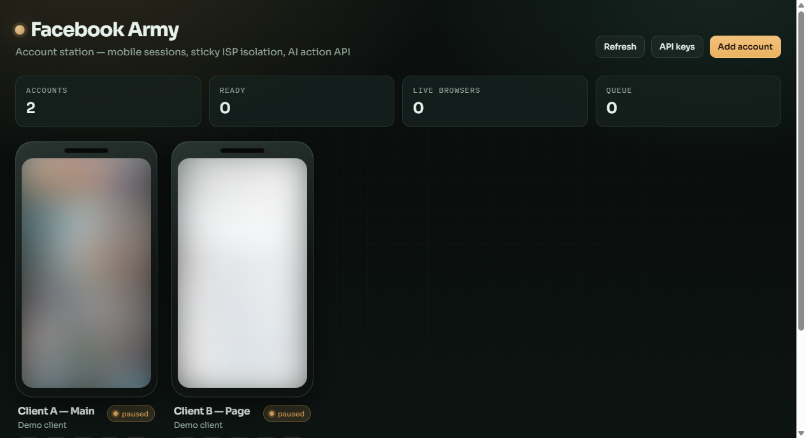
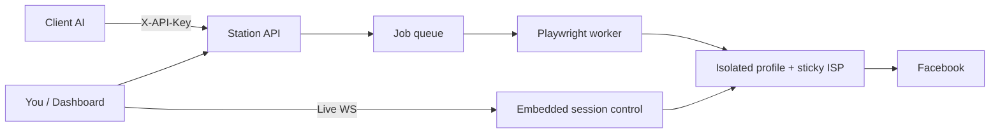

# Facebook Army

Local **Facebook account station** for agencies and operators who manage client pages/groups with sticky ISP proxies, a fleet dashboard, and a REST API that client AI agents can call.

> **Not affiliated with Meta.** Browser automation outside the Graph API can violate Facebook’s terms and risk account checkpoints. Use only on accounts you’re authorized to manage, with human-in-the-loop workflows.



*Fleet view — each account is a mobile session tile with live status and icon actions. (Previews blurred for this public screenshot.)*

## What it does

- Run many Facebook accounts as **isolated Chromium profiles**
- Route each account through its own **sticky ISP proxy** (or this machine’s IP for testing)
- **Dashboard** on localhost: phone tiles, session popup with live remote control, desktop/mobile toggle
- **Open login** in a real desktop Chromium window (for 2FA / captchas)
- Expose a **scoped REST API** so each client’s AI can post to groups, reply, and read engagement
- Designed for an always-on **Mac Mini** (works on Windows for development too)

## Quick start

**Requirements:** Node.js 20+

```bash
npm run setup          # creates .env, folders, installs deps + Chromium
npm run build
npm start              # http://127.0.0.1:8787
```

Or for development (API + Vite):

```bash
npm run setup
npm run dev            # dashboard http://127.0.0.1:5173 → proxies API on 8787
```

1. Open the dashboard → **Unlock dashboard**
2. **Add account** (leave proxy blank to use this PC’s IP, or paste `user:pass@host:port`)
3. **Open login window** → sign into Facebook in the Chromium window → **Mark ready**
4. Click a phone tile to **control the session** in the popup (live stream)
5. Create an **API key** for that client’s AI

## Architecture

```
apps/api          Fastify API + Playwright workers + SQLite + live WebSocket control
apps/dashboard    React fleet UI
packages/shared   Shared TypeScript types
scripts/setup.mjs First-run setup
ops/              Mac Mini launchd template
data/             Local DB + screenshots (gitignored)
profiles/         Per-account browser profiles (gitignored)
```



## AI agent API

Base URL: `http://127.0.0.1:8787` (or your Tailscale hostname)

| Auth | Header |
|------|--------|
| Client AI | `X-API-Key: fa_...` (scoped to account IDs) |
| Admin | `X-Admin-Token: ...` from `.env` |

| Method | Path | Purpose |
|--------|------|---------|
| `GET` | `/v1/accounts` | List allowed accounts |
| `GET` | `/v1/accounts/:id` | Status |
| `POST` | `/v1/accounts/:id/actions` | Queue `post_to_group`, `reply_comment`, `react`, `read_engagement` |
| `GET` | `/v1/jobs/:jobId` | Poll result |
| `GET` | `/v1/accounts/:id/engagement` | Recent comments |
| `POST` | `/v1/webhooks` | Callback URL for engagement / job events |

### Example — post to a group

```bash
curl -X POST http://127.0.0.1:8787/v1/accounts/ACCOUNT_ID/actions \
  -H "X-API-Key: fa_..." \
  -H "Content-Type: application/json" \
  -d '{
    "type": "post_to_group",
    "groupUrl": "https://www.facebook.com/groups/YOUR_GROUP",
    "text": "Hello from the station",
    "idempotencyKey": "unique-request-1"
  }'
```

Poll `GET /v1/jobs/:jobId` until `succeeded` or `failed`.

## Proxies

- **Client accounts:** assign a sticky ISP proxy **before** the first login so Facebook never sees your home IP for that profile
- **Your test account:** proxy can be blank (this PC’s IP)
- Format: `user:pass@host:port`
- One dedicated sticky IP per Facebook account

See [SECURITY.md](SECURITY.md) for what must never be published.

## Mac Mini (always-on)

1. Copy the project folder via thumb drive, including **`.env`**, **`data/`**, and **`profiles/`** if migrating an existing station
2. Install Node 20+, then:

```bash
npm install
npx playwright install chromium
npm run build
npm start
```

3. Optional: edit paths in [`ops/mac-mini.plist`](ops/mac-mini.plist) and load with `launchctl`
4. Reach the API over **Tailscale** (recommended) instead of opening the port to the public internet

## Environment

Copy from `.env.example` (or run `npm run setup`):

| Variable | Purpose |
|----------|---------|
| `PORT` | Default `8787` |
| `HOST` | Default `0.0.0.0` (reachable via Tailscale IP; use `127.0.0.1` to lock local-only) |
| `MASTER_KEY` | Encrypts stored passwords / proxy secrets |
| `ADMIN_TOKEN` | Dashboard + admin API auth |
| `MIN_ACTION_GAP_MS` | Per-account pacing between actions |
| `MAX_CONCURRENT_JOBS` | Parallel Playwright jobs |

## Privacy on this public repo

The published tree does **not** include:

- `.env` / tokens
- `data/` (database, screenshots)
- `profiles/` (logged-in browser sessions)

Those stay on your machine only. The fleet screenshot above was redacted (blurred previews, demo labels) so no live session content is in git.

## License

Use at your own risk. You are responsible for complying with Meta’s terms and applicable law.
